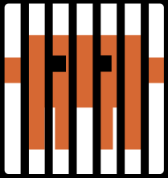

# prison-pod

<p align="center">
  
</p>

On-demand Claude Code sandboxes on Kubernetes. Create a `PrisonPod` and a small [kopf](https://kopf.readthedocs.io) operator starts a locked-down pod that clones your repos and runs `claude remote-control`. You drive the session from [claude.ai/code](https://claude.ai/code) or the Claude app, where it shows up under the PrisonPod's name.

```yaml
apiVersion: prisonpod.fdr2026.dev/v1alpha1
kind: PrisonPod
metadata:
  name: fix-login-bug
spec:
  repos:                                    # cloned to /data/workspace/<name>
    - name: api
      url: https://github.com/org/api.git
      ref: main                             # optional branch or tag
  credentialsSecretRef:
    name: claude-credentials                # see Usage
  gitCredentialsSecretRef:                  # optional, see Private repos
    name: git-credentials
  permissionMode: auto                      # default: auto
  git:
    name: Your Name
    email: you@example.com
  egress:                                   # optional, see Network
    - host: registry.npmjs.org              # ports default to [443]
    - host: "*.githubusercontent.com"
  ssh:                                      # optional, see SSH
    authorizedKeys:
      - ssh-ed25519 AAAA… you@laptop
```

```console
$ kubectl get pp
NAME            READY   REASON              REPOS     SESSION                               AGE
fix-login-bug   True    SessionRegistered   api       https://claude.ai/code/session_01AbC…  3m
```

## How it works

```
PrisonPod ──owns──> PVC prison-pod-<name>                   mounted at /data
          ├─owns──> CiliumNetworkPolicy prison-pod-<name>   default deny
          └─owns──> Deployment prison-pod-<name>            1 replica, Recreate
                      └─ Pod (uid 1000, no capabilities)
                          ├─ init clone-<repo>   git clone, skipped if present
                          ├─ agent               claude remote-control
                          └─ ssh (optional)      sshd on 127.0.0.1:2222
```

- The operator reconciles every 10 seconds with server-side apply, so drift is corrected and spec changes roll out.
- The `Ready` condition tracks progress (`PodPending`, `Cloning`, `CloneFailed`, `AgentNotRunning`, `WaitingForSession`, `SessionRegistered`); the session URL lands in `status.sessionURL`.
- Workspace, `$HOME` and the session pointer live on the PVC. A restarted pod resumes the previous session (`--continue`) or starts a new one if that fails.
- `permissionMode`, `git`, `ssh`, `gitCredentialsSecretRef` and the repo list can be edited; the pod restarts and resumes. `egress` changes apply live. Existing repo entries and `credentialsSecretRef` are immutable.
- Deleting the PrisonPod deletes everything it owns, including the data.

## Install

Every push to `main` publishes `ghcr.io/hanneseberhard/prison-pod-{operator,agent}` tagged with the commit SHA. Then:

```sh
just images   # pin main's image digests into .images.yaml (or: just images <commit>)
just deploy   # helm upgrade --install into namespace prison-pod
```

Images must be pinned by digest. To use your own, set `operator.image` and `sandbox.image`. Other values (`storageClass`, `storageSize`, `runtimeClassName`, `essentialHosts`, `resources`) are in [chart/values.yaml](chart/values.yaml). The CRD ships with the chart; `helm uninstall` keeps it and all PrisonPods.

## Usage

Remote Control needs a claude.ai subscription login, not an API key. Log in once with `claude auth login`, then store the credentials with your `oauthAccount`:

```sh
kubectl -n prison-pod create secret generic claude-credentials \
  --from-file=.credentials.json=$HOME/.claude/.credentials.json \
  --from-file=oauthAccount.json=<(jq .oauthAccount ~/.claude.json)
kubectl apply -f examples/hello-world.yaml
kubectl -n prison-pod get pp
```

Claude gets a generated system prompt describing its sandbox (repos, tools, network rules, how to ask you for an egress entry), built from [agent/system-prompt.md](agent/system-prompt.md).

There's no root or `apt`; Claude installs tools rootless into `$HOME` (`uv tool install`, `mise use -g`), which persists.

## Private repos

```sh
kubectl -n prison-pod create secret generic git-credentials --from-literal=token=<token>
```

Reference it as `spec.gitCredentialsSecretRef`. Optional keys: `username` (default `x-access-token`) and `host` (default `github.com`). A credential helper sends the token only over https to `host`. Claude can read the token, so use a fine-grained, short-lived one scoped to what the sandbox needs.

## SSH

`spec.ssh.authorizedKeys` adds an sshd sidecar on `127.0.0.1:2222`, reachable only through kubectl. Use a dedicated key (`ssh-keygen -t ed25519 -f ~/.ssh/prison-pod`) and add to `~/.ssh/config`:

```
Host *.pp
  User agent
  IdentityFile ~/.ssh/prison-pod
  IdentitiesOnly yes
  ProxyCommand sh -c 'exec kubectl -n prison-pod exec -i "deploy/prison-pod-${0%%.pp}" -c ssh -- nc 127.0.0.1 2222' %h
```

Then `ssh hello-world.pp`, `scp`, `rsync` and VS Code Remote-SSH work.

## Network

Requires [Cilium](https://cilium.io) with its L7 proxy. Each sandbox denies all ingress and all egress except DNS, the Claude hosts (`sandbox.essentialHosts`), the repo hosts on 443 and the entries in `spec.egress` (hostnames or one-level `*.domain`, with optional `ports`). Package registries such as `pypi.org` or `registry.npmjs.org` must be listed explicitly.

## Limitations

- The credentials Secret is a full account login. Each sandbox refreshes its own token copy, so the Secret can go stale; recreate it if new sandboxes fail to log in.
- Data lives on the PVC; with node-local storage, losing the node loses it. Push your work.
- One git token per PrisonPod, for one host, https only.
- DNS lookups aren't restricted, so data can still leak through DNS queries.

## Development

```sh
just test    # operator unit tests
just lint    # helm lint and image pinning checks
```

The operator: [manifests.py](operator/manifests.py) builds the objects, [status.py](operator/status.py) derives status, [main.py](operator/main.py) holds the kopf handlers.
